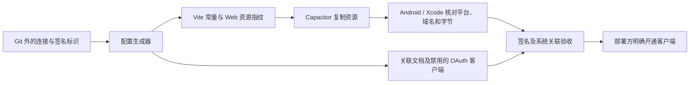

# 原生 HTTPS 回调的构建与验收

正式原生登录使用系统浏览器、各平台独立的 HTTPS 回调和客户端标识。缺少构建绑定时显示 `NATIVE_LINKS_REQUIRED`，不能回退到开发用私有 scheme。Web 客户端继续使用自己的回调。

| 平台 | OAuth 客户端 | 回调路径 | 退出路径 |
| --- | --- | --- | --- |
| iOS | `paperquay-ios` | `/auth/native/ios/callback` | `/auth/native/ios/logout` |
| Android | `paperquay-android` | `/auth/native/android/callback` | `/auth/native/android/logout` |

实际域名、服务地址、签名标识和生成配置保存在 Git 外。`tests/fixtures/native-link-settings.json` 只包含合成构建数据。

## 构建配置



输入格式参考合成夹具。iOS 的 `applicationIdentifierPrefix` 须取自实际签名应用的 `application-identifier` 前缀；Android 指纹须取自实际分发渠道的应用签名证书。使用 Play App Signing 时核对应用签名证书与上传证书的区别。输入文件不接收密码、token 或私钥。

在项目根目录运行下列命令，路径由部署方替换：

```sh
npm run configure:native-links --prefix apps/mobile -- \
  --input /private/operator/native-input.json \
  --output /private/operator/native-ios --platform ios
PAPERQUAY_NATIVE_LINK_SETTINGS=/private/operator/native-ios/native-build.settings.json \
  npm run build --prefix apps/mobile
```

生成器拒绝 Git 内路径、已有输出目录、不完整配置和无效签名标识。输出包括构建设置、`.well-known` 关联文档、`NativeLinks.xcconfig`、服务端公开关联设置及**默认禁用**的 OAuth 客户端模板。生成成功时，签名和 OS 关联状态仍为未验证。

Vite 从指定设置写入必要的公开常量，生成 `native-link-binding.json`，记录回调绑定及 Web 资源的 SHA-256。构建产物进入忽略的 `dist`；实际设置和运维文档继续留在 Git 外。普通 Web 服务镜像沿用运行时配置，不接收这些实际参数。

Android 在 `cap sync android` 后从已复制的绑定文档取得清单域名，`preBuild` 核对平台、回调和资源字节。额外设置的 `PAPERQUAY_NATIVE_LINK_HOST` 也必须一致。iOS 使用同次生成的配置：

```sh
cd apps/mobile
npx cap sync ios
xcodebuild -project ios/App/App.xcodeproj -scheme App \
  -xcconfig /private/operator/native-ios/NativeLinks.xcconfig \
  -configuration Release -sdk iphoneos build
```

签名团队、描述文件和分发渠道由部署方在受控环境配置。Xcode 校验阶段检查域名设置和已复制资源。没有绑定文档的普通构建只允许 `unconfigured.invalid`，保持原生登录未配置状态。上述命令不发布应用或开启生产客户端。

## 服务端关联文档

以下环境变量默认不配置，实际值保存在 Git 外：

| 变量 | 内容 |
| --- | --- |
| `PAPERQUAY_NATIVE_LINK_ORIGIN` | 无端口、路径、凭据的规范 HTTPS origin |
| `PAPERQUAY_NATIVE_IOS_APPLICATION_IDENTIFIER_PREFIX` | 实际签名应用的十位前缀 |
| `PAPERQUAY_NATIVE_ANDROID_CERTIFICATE_SHA256` | 一至四个逗号分隔、去重的大写冒号格式 SHA-256 指纹 |

生成的 `server-associations.settings.json` 提供该平台的公开配置值，可由部署方合并到受控 `sync.env`，随现有完整备份恢复。两个 `.well-known` 路径由 Web 入口转给 API；请求主机名与 origin 一致、对应平台已配置时返回 JSON，其余情况返回 404。这些路径共用匿名限流，不读取账号数据。

关联文档公开后，部署方须检查实际签名产物和 OS 关联状态，再明确开通对应 Keycloak 客户端，并把该客户端 ID、精确 WebView origin 加入 API 白名单。iOS 默认 origin 为 `capacitor://localhost`，Android 为 `https://localhost`。关联设置不会自动修改 OAuth 客户端、API 客户端白名单或 CORS。

原生客户端使用 Code + S256 PKCE、精确回调和 API audience；生产 realm 继续使用单次刷新令牌策略。禁止密码授权、隐式授权和私有 scheme 的生产回调。

## 验收证据

| 范围 | 需要证明的结果 |
| --- | --- |
| 自动化回归 | 平台隔离、错误回调拒绝；错误域名、资源变更和配置缺失时拒绝构建 |
| CI 编译 | Android 与 iOS 可编译合成域名绑定；iOS 模拟器编译不签名 |
| 实际签名 | APK/应用的证书或 entitlement 与关联文档一致，分享扩展签名和应用组正确 |
| OS 关联 | Android 系统显示 `verified`；iOS 将关联链接交给实际签名应用 |
| 实际登录 | 系统浏览器 Code PKCE 往返、冷启动回调、重复与错误平台回调拒绝、退出和刷新令牌轮换 |

CI 的合成域名和证书标识不用于公网发布。四类设备、辅助技术、冷启动及签名分发继续按 [验收标准](acceptance.md) 记录。

## Android 签名产物核对

签名后、分发前，用 Python 3.11+ 和 Android SDK Build Tools 35.0.0 核对最终 APK。实际设置和关联文档使用同一次生成的 Git 外文件；`web-bundle` 指向该次 `cap sync android` 复制的资源目录：

```sh
python3 apps/mobile/scripts/verify-android-release.py \
  --apk /private/operator/PaperQuay-release.apk \
  --settings /private/operator/native-android/native-build.settings.json \
  --association /private/operator/native-android/.well-known/assetlinks.json \
  --web-bundle apps/mobile/android/app/src/main/assets/public \
  --build-tools "$ANDROID_HOME/build-tools/35.0.0" --java "$JAVA_HOME/bin/java" \
  --version-code 1 --version-name 1.0
```

版本参数应改为该次发行的预期值。工具使用 SDK 校验密码学签名及对齐，拒绝调试签名，核对分发证书、包名、版本、HTTPS 回调及完整 Web 资源字节，并拒绝开启调试、备份或明文流量的包。输出包括 APK SHA-256 和实际证书指纹，不读取私钥，也不发起网络请求或开通客户端。Play App Signing 分发的 APK 须使用应用签名证书对应的关联文档。

CI 使用临时签名身份，执行真实签名验证及未签名、错证书、错版本、调试签名和签名后篡改的拒绝检查。这些结果只证明本地产物核对流程；系统域名关联、真实登录、签名保管和分发验收仍需各自的记录。

平台依据：[Capacitor Universal/App Links](https://capacitorjs.com/docs/guides/deep-links)、[Android 系统关联验证](https://developer.android.com/training/app-links/verify-applinks)、[Apple 关联域名](https://developer.apple.com/documentation/xcode/supporting-associated-domains)。
