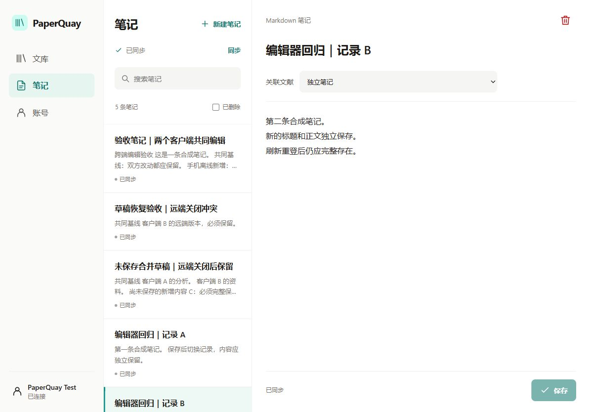
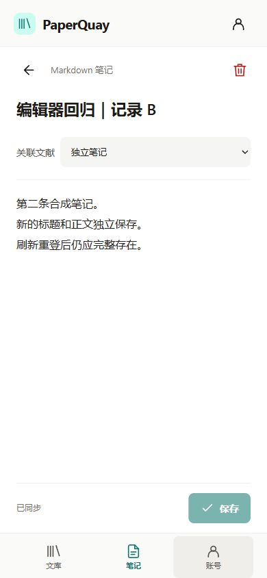
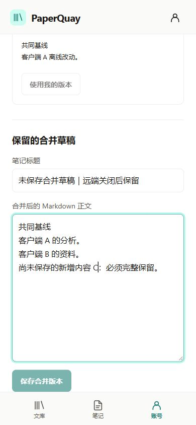
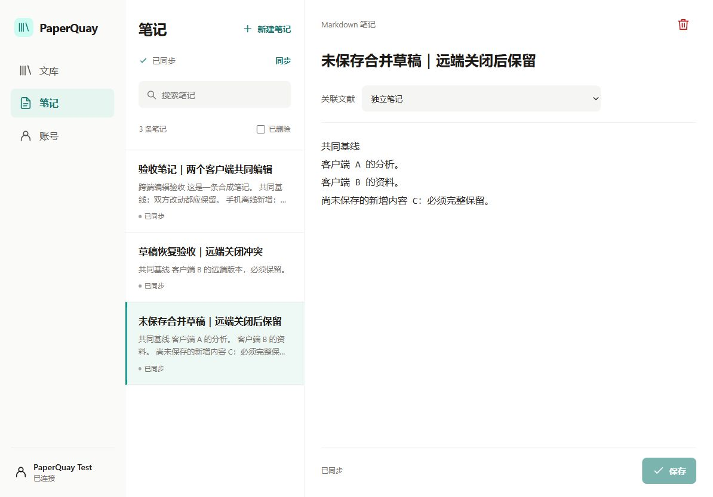
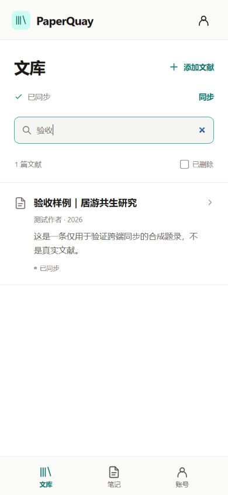
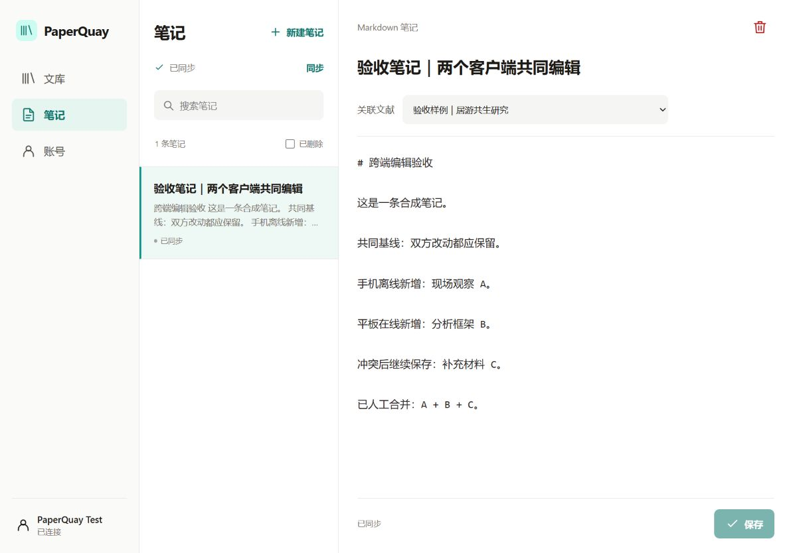

# M1 本机集成与视觉验收

验证日期：2026-10-23 至 2026-10-25。基线为 `6e137a3d81e3f1198766c9d199c9c68440dff7f3`，分支为 `feat/mobile-account-sync`。证据对应包含本记录的提交；最终 SHA、CI 与代码/安全审查结果以 [PR #34](https://github.com/mikutea/PaperQuay/pull/34) 为准。

本次交付可运行的账号同步基础。真实用户文库、正在运行的桌面应用、CN-DC-01 及其他生产服务均未参与测试。题录、笔记和账号均为隔离环境中的合成数据。

2026-10-24 曾按用户要求暂停并保存本地提交 `6712a0f`；2026-10-25 恢复工作，已创建 PR #34。首轮及 `e048468` 的 5 项 CI 全部通过，真实 PostgreSQL/Keycloak 容器工作流已在 Actions 执行。审查和补充复核发现的问题已加入下述修复和回归；后续提交须重新通过当前 SHA 的 CI、代码与安全审查。为补充界面验证重新启用了本机隔离服务，测试结束后关闭，数据库及配置保留。

## 环境与自动化结果

| 项目 | 实际结果 | 说明 |
| --- | --- | --- |
| 桌面全量 Node tests | 687 通过，0 失败，0 跳过 | 含 44 项同步核心/投影测试；审查修复后重跑 |
| 桌面 TypeScript / Vite build | 通过 / 通过 | 保留现有较大 chunk 提示；未改 Reader UI |
| Electron 原生文件模块 smoke | 通过 | Electron 42.11.9，Windows x64；不是安装升级验收 |
| 同步服务单元测试 | 19 通过 | 协议、配置、鉴权、错误脱敏、保留字节配额及代理/账号限流隔离 |
| 真实 PostgreSQL / OIDC 集成 | 34 通过，0 跳过 | 原有 18 项、11 项配额事务、1 项旧库迁移及 4 项恢复/依赖契约；非 owner、非 superuser、NOBYPASSRLS runtime 角色 |
| 同步服务 TypeScript | 通过 | 严格类型检查 |
| 移动客户端测试 | 90 通过 | 31 项控制器、21 项冲突组件、16 项普通编辑器组件、6 项实际 App 选择回归及 16 项其他测试；IndexedDB、账号隔离、故障恢复、冲突和 API 验证 |
| 移动客户端 TypeScript / Vite build | 通过 / 通过 | 独立 React/Vite 构建 |
| 依赖审计 | 服务 production 依赖与移动模块均为 0 项漏洞 | 本次安装/审计时的结果；不是永久安全保证 |

本机使用 Node 24.14.0、PostgreSQL 18.6、Keycloak 26.8.1、Temurin 25.0.4.1。PostgreSQL、身份服务、API 和前端均只监听回环地址。可重复的 CI 入口是 [mobile-sync.yml](../../../.github/workflows/mobile-sync.yml)，其独立数据库和测试 realm 每次重新生成；自动化缺少集成配置时失败，不以跳过冒充通过。

开发用 `start-dev`、仅限本机的测试数据库认证与临时合成凭据不适用于生产。Compose 文件是运行参考，本机实际使用独立 Windows 进程。数据库 OS 级重启、备份恢复、跨网性能和真实移动硬件另行验收。

## 2026-10-25 审查修复

| 问题 | 修复行为 | 回归证据 |
| --- | --- | --- |
| P1：笔记排在其关联文献前，缺少依赖会阻塞整个同步队列 | 暂缓失败操作并持久化移至队尾；让其他操作先发送，有成功写入后才重试依赖；普通可重试错误等待下一次触发 | 控制器验证 N→P→N，原 opId/载荷不变；永久缺依赖不空转，无关操作仍能提交 |
| P2：离线恢复记录后继续编辑，恢复意图被普通保存替换 | 尚未尝试发送的恢复保留 `restore` 和原版本基线；尝试发送后的请求固定，后续编辑成为 overlay | 核心 3 项及控制器 2 项回归覆盖恢复后编辑、再删除和请求发送期间编辑 |
| P2：另一设备解决冲突后，本机未审阅的后续编辑静默覆盖远端内容 | 远端关闭冲突使用独立状态转换；保留本机编辑的旧版本基线，让服务端重新判断冲突 | 核心 4 项及控制器 1 项回归证明远端 revision 4 保持不变，本机 C 保留并进入新冲突 |
| P2：另一设备关闭冲突时，正在输入的合并草稿被自动切换清空 | 保留选中冲突快照、标题、正文及脏状态；停用旧解决按钮，允许另存为新笔记；已离开或切换的草稿不接受旧异步回调 | 实际组件重渲染和挂起请求回归；真实双客户端验证草稿保留、另存、原远端内容未改及刷新恢复 |
| P1：待重试的冲突解决请求先于依赖执行，导致整个队列停止 | 解决请求与 outbox 交错推进，暂错保留原请求并持久化轮转；到达单轮上限后仍拉取远端并显示未完成 | 原请求重放、普通暂错/丢 ack、远端 CAS、101 项公平轮转、仅剩解决请求的预算边界、鉴权/非法响应及终态后刷新失败回归 |
| P2：普通编辑器旧操作完成后清除另一条记录的新草稿 | 保存、删除、恢复的成功/失败/结束回调均受编辑会话保护；卸载或更换记录/控制器立即使旧会话失效 | 16 项实际组件回归，修复前 13 项失败；真实页面补验保存、切换、刷新重登及手机返回/重开 |
| 安全 P2：只限制历史条数，大正文的多份副本仍可能耗尽共享存储 | 事务内按账号计入实体、变更、回执和冲突正文；超额整笔回滚，并返回可重试拒绝，保留历史和本机改动 | 11 项真实配额事务、1 项超过默认配额的旧库迁移、2 项配置/能力单元和 2 项客户端拒绝恢复回归 |
| P2：取消未上传论文后，关联笔记永久缺少依赖 | 有待同步关联笔记时保留论文创建，再以其确认版本提交删除；保留笔记原请求与后续解除关联编辑 | 4 项核心回归覆盖尝试前后、重启、多笔记及 overlay-only 引用；真实 PostgreSQL 验证墓碑引用、精确重试及后续解除关联 |
| P2：另一设备先恢复论文后，“使用我的版本”仍发送 restore 而失败 | 对已审阅且存活的记录明确提交完整本机内容的 put；墓碑仍需显式恢复 | 9 项实际冲突组件回归；真实 PostgreSQL 验证论文/笔记竞争恢复、丢失确认重放，以及选择到达前再次删除时的 CAS 保护 |
| 安全 P2：反向代理后匿名健康检查可占满所有用户共用的业务额度 | 业务按已验证 issuer/sub 共用账号额度，健康与匿名请求各自独立；仅显式代理 IP 可传递可信客户端地址 | 4 项 HTTP 回归覆盖健康洪泛、账号/会话/路由聚合、代理链与伪造 XFF、认证失败；1 项配置回归拒绝宽泛代理信任 |
| P2：平板重复选择当前记录后，父组件错误清除未保存保护 | 完整类型和 ID 相同时直接保留当前选择，不触发放弃确认或重置脏状态；真正切换仍确认 | 6 项实际 App/编辑器回归，修复前 2 项失败；真实平板重复点击、续写、保存和手机重开保留完整正文 |

上述客户端失败均在修复前复现。首轮新增 7 项核心和 6 项移动控制器回归，后续补充 12 项直接渲染实际冲突组件的回归，其中 4 项验证卸载或切换草稿后的旧异步回调失效；未改生产服务。故障注入的 API/IndexedDB 替身用于状态机和组件行为测试，真实服务验证仍由独立 PostgreSQL/OIDC 工作流提供。

在 `c173999` 审查后又增加 12 项控制器和 16 项普通编辑器组件回归，移动端合计 73 项通过。三名子智能体分别修复控制器、修复编辑器和独立核对状态机/补丁；独立复核补到了大队列公平性，以及请求已结算但后续刷新失败时不应误要求重新登录的边界。`c173999` 的五项 CI 与安全审查已通过；修复后的提交仍须重新核验当前 SHA 的全部检查。

### 按账号限制保留字节

`1572d20` 的代码审查和五项 CI 通过后，安全审查指出仅限制记录条数不足以约束大正文的历史增长。修复为默认 256 MiB/账号的保留字节预算；配置必须为正整数且最多 10 GiB。计量包含 `entities.data`、`changes.record`、`operation_receipts.result` 及冲突中的尝试操作/观察快照，按 PostgreSQL JSONB 的 UTF-8 文本字节加每行 512 字节保留额计算。它限制应用保留量，不是 PostgreSQL 物理文件、索引或 WAL 的磁盘硬上限。

数据库在账号锁下对每份新增副本或更新差额检查预算，实体 UPSERT 不重复计费。第二份副本或回执不够空间时，实体、历史、序号、冲突关闭和计数全部回滚；事务外返回标准 `ACCOUNT_STORAGE_LIMIT`、`retryable:true`，不保存永久拒绝回执。已有回执的幂等重放优先于配额判断，满额账号仍能读取历史。当前不剪裁历史，避免破坏 cursor 与幂等保证；需要维护者调整一致的服务配置后再重试。

真实 PostgreSQL 回归覆盖多字节精确临界、正文增减与墓碑、只差回执最后一字节的回滚、两条独立连接并发、满额成功/冲突/拒绝回执重放、账号隔离，以及各冲突解决分支和大冲突正文绕过。另用 001/002 创建超过 256 MiB 的旧账号，验证 003 完整回填 363 行历史、恢复六表 FORCE RLS、保留读取并拒绝继续增长；该专用 schema 的全部 DDL/数据在测试末尾回滚。

本机实际从 001/002 升级的合成库有 91 个账号、636 条保留记录，合计 1,032,371 字节。003 回填后逐账号与独立聚合比对为 0 差异，重复迁移无新增操作。服务最终 14 项单元与 30 项真实集成均通过；移动端 75 项通过，新增两项使用真实响应解析与控制器验证原请求/后续编辑跨 IndexedDB 重启保留、无自动空转和假同步完成、额度恢复后精确重试。客户端明确提示额度不足及改动仍保存在本机。这些配额场景是自动化集成与故障注入证据，不扩展为原生实机或生产容量验收。

### 反向代理与业务限流隔离

`380fc02` 的安全复核指出，默认不信任代理时，反代后的所有请求共用代理 IP 的全局计数器，匿名健康请求可能阻断认证用户。现在复用一个限流 store，并分别使用 `account:`、`health:` 与 `public:` 键。业务账号键只由已验证的 issuer/sub 哈希构成；跨业务路由、会话、来源地址或允许的 OIDC client 仍共用同一额度。认证失败只计匿名来源额度，不占用任何账号额度。健康存活和就绪接口共用独立健康额度。

新增 `PAPERQUAY_TRUSTED_PROXY_IPS` 默认为空，仅接受至多 32 个明确 IPv4/IPv6 地址，拒绝布尔值、通配符、CIDR、主机名和未指定地址。Fastify 从直连对端逐跳校验转发链，在最近的不可信地址停止；未配置或来自不可信对端的 XFF 无法更换限流键。HTTP 测试还确认账号限流不是每个路由重新起算，健康及匿名额度耗尽后认证账号仍可工作。

限流是每个进程的内存计数，重启会重置；它不构成多实例总量限制或边缘 DDoS 防护。真实反向代理部署和生产流量未在本轮执行。最终服务 19 项单元及 34 项 PostgreSQL/Keycloak 集成通过，均未跳过。

### 取消未上传论文与竞争恢复

`380fc02` 的五项 CI 全部通过后，代码审查发现两处此前未覆盖的恢复边界。核心新增 4 项测试在修复前全部失败；修复后 44 项核心与 687 项桌面全量通过。取消论文创建时，如果 outbox 或 overlay 还有关联笔记，保留原创建请求和删除意图，收到创建确认后再生成带版本基线的删除。已尝试笔记的 opId/载荷不变，后续解除关联和正文编辑跨重启保留；没有关联笔记时沿用直接取消行为。

移动组件新增 9 项回归，其中 3 项在旧实现失败。点击“使用我的版本”时先取用户已审阅的最新 overlay 或原始冲突操作；若意图是 restore 且审阅的当前记录已经存活，明确提交相同完整内容的 put。当前记录仍是墓碑时保留 restore，普通 put/delete 不变，版本与 overlay 变化仍要求重新比较。

新增 4 项真实 PostgreSQL 测试验证：论文和笔记的竞争恢复均可采纳本机版本，完整字段保留且确认丢失后可重放；用户点击后另一设备再次删除会返回新冲突，不越过 CAS 自动复活；关联笔记在论文创建并删除后可精确重试成功，再提交解除关联的后续编辑。本轮这两处并发路径的证据来自实际 React 组件与真实数据库，未另外声称原生设备或浏览器竞态验收。

这轮恢复修复后，移动端 84 项测试和类型检查通过。一次标准构建遇到 Windows 共享盘 `dist/assets` 的 OS 183，检查后保留原产物，改用独立本地临时输出目录构建成功；标准 Linux 构建由 CI 核验。

### 重复选择当前记录的未保存保护

`6466ba4` 的安全复核通过后，代码复核发现平板三栏布局中重复点击当前记录会清除父组件的 dirty 标记，编辑器自身仍为 dirty，后续输入便不能重新启用离开保护。修复在选择入口比较完整的实体类型与 ID，同一条记录不执行离开确认及状态重置；不同类型即使 ID 相同仍视为真正切换。

新增 `appSelection.test.ts` 使用实际 `ConnectedApp` 与 `EntityEditor`，覆盖题录/笔记重复选择后续写与 beforeunload 保护、拒绝/接受切换、新建不同草稿、跨类型同 ID 及返回当前分区时的真正卸载。修复前 2 项失败、4 项通过，修复后 6 项全部通过；移动端全量 90 项、类型检查和独立本地输出目录的生产构建通过。

真实浏览器使用本机 Keycloak/PostgreSQL/API 和新合成笔记：保存基线 → 输入尚未保存的 A → 点击当前列表行 → A 与“尚未保存”状态保留且无放弃确认 → 继续输入 B → 保存 → 切换另一记录 → 重开后 A+B 完整存在并显示已同步。1194×834 与 390×844 两种 CSS 视口均无横向溢出、空白页或框架错误层，Console error/warn 为零，主操作没有遮挡。Browser plugin 不可用，本轮通过 CUA 内置浏览器接口验收；截图保存在任务代码仓库外的 `qa/reselect-dirty-tablet.jpg` 与 `qa/reselect-saved-phone.jpg`。

真实重复点击和保存重开由浏览器证明；放弃确认的接受/拒绝及关闭保护由实际父子组件测试证明，未把组件事件等同于原生浏览器弹窗或实机验收。验收后清除视口覆盖、关闭临时页并停止本轮四项回环服务，保留合成数据库及原有用户页面。

### 普通编辑器保存与切换补验

在冻结本轮代码后，使用真实 Keycloak/PostgreSQL/API，通过 `127.0.0.1:4317` 新建并分别保存两条合成笔记 A、B；来回切换后标题和正文各自保持完整。刷新、真实重登后 B 仍完整并显示已同步；手机端返回列表再打开 B 也通过。

页面标题为 PaperQuay，1194×834 与 390×844 两种 CSS 视口均无横向溢出或错误层，刷新后至重开笔记期间 Console 无 error/warn。截图展示实际保存结果，未增加新的视觉设计。延迟 IndexedDB、旧回调及删除/恢复交错由组件故障注入证明，本次普通浏览器流程不冒充竞态或原生实机验收。已清除视口覆盖、关闭测试页并停止本轮全部服务，原有用户页保留。

### 远端关闭冲突时保留未保存草稿

2026-10-25 在真实 Keycloak/PostgreSQL/API 和两个独立 origin 中重做此流程：A 保存离线编辑，B 保存远端编辑；A 联网产生冲突后输入尚未保存的合并标题及正文。B 选择保留当前版本，A 重新联网同步后仍保留全部输入，明确显示冲突已关闭，原来的三个解决按钮禁用。点击“另存为新笔记”后本机保存并同步；B 拉到完整副本，原 B 内容未变。A 刷新重登后仍能看到副本。

| 界面检查 | 结果 |
| --- | --- |
| 页面身份与非空内容 | 两端均为对应的 `127.0.0.1:4317` / `:4318`，标题 PaperQuay；真实账号和笔记可见 |
| 框架错误层 | 最终页面无错误层；开发热更新期间曾出现暂态 reload 错误，冻结代码并重新加载后消失 |
| Console | 最终刷新、真实重登及重新打开笔记期间无 error/warn |
| 响应式 | 实测 CSS 视口 390×844 与 1194×834，`scrollWidth` 等于视口宽度；提示、正文、按钮可读 |
| 交互 | 草稿内容完整保留、旧提交禁用、另存跨端可见、原远端内容保留、刷新恢复均通过 |
| 证据 | 手机关闭提示及保留正文、平板另存结果截图保存在本任务 `qa/`；下列合成数据截图可公开查看 |

使用内置浏览器 CUA 的真实控件和短暂网络故障注入完成验证；登录与操作均通过实际界面，跨端数据来自真实服务。浏览器级 viewport 设置未作用于后台页时，改用该页 CDP 视口设置并读取实际尺寸。已清除网络/视口覆盖、关闭两个测试页并停止本机测试服务；用户原有 GitHub 页保留。卸载或切换草稿后的异步回调保护由组件回归验证；原生设备和离线冷启动仍不在本项证明范围内。

## 真实浏览器流程

使用内置浏览器直接操作应用；没有注入假登录结果或预设同步成功。客户端 A 为 `127.0.0.1:4317`，客户端 B 为 `127.0.0.1:4318`，分别拥有独立 IndexedDB。两者在同一浏览器中，可共享身份提供方的 SSO 会话；这是两个独立客户端存储的验证，不是两台物理设备的证明。

1. 通过真实 Keycloak Authorization Code + PKCE 登录 `qa-reader`，创建一条中文合成题录与一条关联笔记；另一 origin 拉取到两条记录。
2. 在手机视口客户端断网后保存增量 A，页面明确显示已在本机保存、待同步；平板客户端在线保存增量 B。
3. 手机恢复联网后出现冲突，继续保存增量 C。刷新并重新登录后，冲突及 C 均保留；页面同时提供本机最新版本和原始冲突提交。
4. 人工合并 A+B+C，服务器确认后冲突消失；另一客户端刷新重登后得到完整合并正文并显示已同步。
5. 手机搜索实际过滤合成题录；390×844 与 1194×834 布局分别核对。下列截图来自真实界面，内容不是真实研究记录。

6. 当前会话的撤销确认由用户点击 OK 后完成：客户端返回登录页；重新登录后设备列表显示旧会话“已撤销”和一个新的当前会话，原文库恢复。旧 token 和同 sid 刷新 token 的直接拒绝由真实 OIDC 集成测试另外验证。
7. 同一 origin 退出 `qa-reader`，登录 `qa-other`，文库为 0、笔记为 0；退出并切回 `qa-reader` 后原题录与完整 A+B+C 笔记恢复，状态为已同步。
8. 停止并重新启动本轮 API 进程；用全新认证会话从 HTTP pull 重新读取数据库，合并笔记 revision=3，A、B、C 和人工合并标记均保留。随后撤销该一次性验收会话。此项是 API 进程重启，不是 PostgreSQL OS 级重启或备份恢复。

撤销及账号隔离截图：[旧会话已撤销](session-revoked.jpg)、[第二账号的空笔记列表](other-account-empty.jpg)。浏览器原生确认框曾阻塞自动化接口，由用户完成确认后继续核验，没有通过宿主应用代点。

| 验收范围 | 本轮证据与边界 |
| --- | --- |
| T01–T03 身份、隔离、撤销 | 真实 discovery/JWKS/JWT/刷新/两个账号与撤销集成；浏览器登录流程 |
| T04–T08 顺序、幂等、冲突、删除、恢复 | 真数据库并发/事务/分页与客户端持久化故障注入；浏览器离线冲突与刷新恢复 |
| T09–T11 账号切换与桌面投影 | 账号/服务隔离、迟到回包、稳定 ID、路径/密钥哨兵、未知历史版本/富文本 skipped 的自动化测试 |
| T12 两客户端与持久化 | 真实两个 origin 的文库/笔记同步；API 进程重启后，全新认证 pull 读到数据库中 revision=3 的完整合并笔记 |
| T27 既有功能 | 全量桌面回归通过；旧用户库/profile/运行实例未接管；未声称本轮重做所有桌面人工验收 |
| T13–T26 后续平台与发布能力 | 除已有单项证据外均待后续阶段；原生、PDF、AI、生产、备份与性能未通过 |

## 视觉对照记录

在同一次 QA 中用 `view_image` 分别查看两张 [概念参考](../design/README.md) 和最新 IAB 截图。概念文件比例对应 390×844 / 1194×834 CSS 视口；浏览器直接使用这两个视口截取。对照的是 M1 已定义的真实工作流和设计 token，而不是把生成图中的示例数据作为产品默认数据。

| 对照点 | 概念与实际证据 | 处理与结论 |
| --- | --- | --- |
| 手机结构 | 顶部品牌、文库标题、同步、搜索、开放列表、底部三项导航 | 已核对；没有横向溢出或主操作遮挡 |
| 平板结构 | 导航轨、笔记列表、弹性编辑区三栏 | 210px / 300px / 剩余宽度保持；选中笔记与编辑区关联清楚 |
| 文案与实际状态 | 文库/笔记/账号、同步、搜索、保存 | 状态由本地持久化和真实服务器结果驱动；没有硬编码成功 |
| 字体层级 | 中文系统字体、24px 主标题、16px 正文、14px 次要文字 | 列表标题、说明、输入、导航均可读；长中文标题自然换行 |
| 颜色与容器 | 白色内容、浅灰背景、teal 强调、分隔线 | 使用规格 token；开放列表及浅色选中行，无额外卡片网格或渐变 |
| 图标与摘要 | 轮廓文档/账号/笔记图标、列表尾部箭头、两行摘要 | 最终修正题录缺失的文档图标、箭头和真实摘要展示；保持统一描边 |
| 交互和尺寸 | 手机底部导航、平板持续导航、保存按钮 | 使用真实控件，主要触控目标至少 44px；浏览器流程通过，原生触控尚未证明 |

首屏文案差异已按 [实现前的必要调整](../design/README.md#实现前记录的必要调整) 记录：去掉尚未实现的“未归类”，加入真实“添加文献”和关联选择；测试数据替换概念样例；Markdown 使用可编辑文本与明确保存入口。品牌小图标沿用项目视觉体系，导航的文库采用书架意象；不增加未实现业务入口。按这些已说明的 M1 调整对照，当前两种布局没有遗留遮挡、溢出或错误状态等实质视觉问题。

## 尚未达到的产品门槛

- iOS/Android 只有 Capacitor 配置入口，未生成或验收原生项目；无系统安全存储、系统浏览器登录、后台/锁屏生命周期证据。
- M1 页面刷新后重新登录；已打开页面可离线保存，但不能宣称离线冷启动 PWA。
- PDF 获取/阅读/划线、外部模型直连、旧 Reader 双向同步、富文本无损迁移及完整桌面业务均在后续阶段。
- “设备”当前绑定 OIDC 登录会话，不能代表硬件可信身份，也不证明 Bearer token 失窃防护。
- 正式域名/TLS、生产部署、签名发布、真实设备、备份恢复和容量测试未执行。已有启动 SQLite 路径 P2 独立保留，不因本轮通过而消失。
